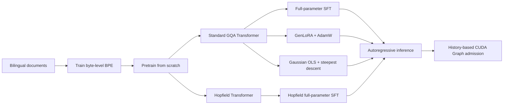

# From-Scratch LLM Training & Online Inference

[](https://github.com/NewtonLebnitz/from-scratch-llm/actions/workflows/cpu.yml)

A PyTorch implementation of bilingual language-model pretraining, supervised fine-tuning, and request-aware CUDA Graph scheduling. Standard GQA Transformer and modern Hopfield attention share the training workflow.

The project covers **model implementation → data processing → bilingual pretraining → SFT → autoregressive generation → inference benchmarking**. Its main optimization task is to reduce the total time required to answer a request while preserving the output, without knowing the lengths of future requests.

## Highlights

- **From-scratch components:** byte-level BPE, RMSNorm, RoPE, GQA, SwiGLU, AdamW, and the training loop. The language model does not use prebuilt Transformers model architectures.
- **Two architectures:** 18 layers, hidden size 768, 12 query heads / 3 KV heads, and approximately **161 million parameters**. The Hopfield variant ports the authors' attention equations into this GQA architecture; it is not a reproduction of their complete experimental setup.
- **Training workflow:** bilingual pretraining; full-parameter SFT, GenLoRA-style RBF low-rank adaptation, and Gaussian OLS + steepest descent for the standard model; separate full-parameter SFT for the Hopfield model.
- **Online inference:** KV cache, packed projections, shared RoPE, last-query-only computation in the final prefill layer, a Triton kernel for Hopfield decoding, and Capture / Replay decisions based on measured historical costs and predicted reuse.
- **Runnable entry points:** a small CPU demo, a synthetic-data generator, unit tests, full-size architecture configurations, benchmark protocols, and historical aggregate results.

## Workflow



## Measured Results

**Historical GPU experiments: four models, each evaluated on 256 domain questions and 32 everyday questions over three rounds.** Common model loading and warm-up are excluded; method-specific compilation, trial capture, Capture, and blocking waits are included. The table reports the mean per-request time across the complete rounds, not the fastest individual run.

| Model | Fastest tested baseline, ms/request ↓ | Dynamic online method, ms/request ↓ | Time reduction | Speedup ↑ |
|---|---:|---:|---:|---:|
| Standard full-parameter SFT | 91.59 | **54.46** | 40.5% | 1.68× |
| GenLoRA SFT | 91.13 | **50.60** | 44.5% | 1.80× |
| OLS + steepest-descent SFT | 122.83 | **59.60** | 51.5% | 2.06× |
| Hopfield full-parameter SFT | 105.71 | **52.28** | 50.5% | 2.02× |

The corresponding paths were checked for complete token-sequence and EOS agreement on the frozen workload. Precision settings differ between some paths, so these results compare complete execution configurations that passed the output checks. They do not isolate the causal effect of the scheduling policy at identical precision, nor imply that every steady-state metric is the best. See [full results and ablations](docs/RESULTS.md) and the [timing protocol](docs/BENCHMARK_PROTOCOL.md).

## Quick Start

Use Python 3.12+ and install a suitable PyTorch build for your machine. All commands below default to CPU and do not automatically use a GPU.

```bash
python -m venv .venv
# Linux: source .venv/bin/activate
# Windows PowerShell: .venv\Scripts\Activate.ps1
python -m pip install -r requirements.txt
python -B -m unittest discover -s tests -v
python -B scripts/make_demo_data.py --output .runtime/input
python -B main.py --workspace .runtime/run prepare --corpus .runtime/input/pretrain --name demo --vocab-size 512
python -B main.py --workspace .runtime/run pretrain --config configs/pretrain-demo.json --name demo-base
python -B main.py --workspace .runtime/run generate --kind base --checkpoint artifacts/models/demo-base/best.pt --tokenizer demo --prompt "The robot" --max-new-tokens 8
```

Then run full-parameter SFT:

```bash
python -B main.py --workspace .runtime/run register-sft --name demo-qa --tokenizer demo --train .runtime/input/sft/train.jsonl --dev .runtime/input/sft/dev.jsonl
python -B main.py --workspace .runtime/run sft --config configs/sft-full-demo.json --name demo-full
python -B main.py --workspace .runtime/run generate --checkpoint artifacts/models/demo-full/best.pt --tokenizer demo --prompt "What is a robot?" --max-new-tokens 8
```

The small configurations train for only two steps to validate the execution pipeline; **they do not produce the full trained model's question-answering capability**. All three standard SFT routes start directly from the same pretrained checkpoint, rather than continuing from one another. See the [usage guide](docs/USAGE.md) for complete commands and data formats.

## Code Map

| Component | Source |
|---|---|
| CLI and data registration | [main.py](main.py) |
| Byte-level BPE | [bpe.py](src/mlsystem/bpe.py) |
| GQA / RMSNorm / SwiGLU / RoPE | [components.py](src/mlsystem/components.py) |
| Transformer and cross-layer Hopfield state | [model.py](src/mlsystem/model.py) |
| Pretraining and checkpoints | [training.py](src/mlsystem/training.py) |
| SFT / GenLoRA / OLS | [sft.py](src/mlsystem/sft.py), [genlora.py](src/mlsystem/genlora.py), [ols_rbf.py](src/mlsystem/ols_rbf.py) |
| Online benefit estimation and graph-pool management | [online_cuda_policy_v2.py](inference_cuda/online_cuda_policy_v2.py) |
| Request timing, Capture, and Replay | [online_cuda_engine_v2.py](inference_cuda/online_cuda_engine_v2.py) |
| Hopfield Triton attention | [hopfield_inference_triton_v1.py](inference_cuda/hopfield_inference_triton_v1.py) |
| Optional PCA + SOM retrieval | [retrieval.py](src/mlsystem/retrieval.py) |

Release validation: [28 tests and four CPU SFT pipelines](docs/VALIDATION.md).

Further reading: [architecture](docs/ARCHITECTURE.md) · [training and data](docs/TRAINING.md) · [inference design](docs/INFERENCE.md) · [data card](docs/DATA_CARD.md) · [implementation and references](NOTICE.md).

## Release Scope

This repository contains the portable public core of the engineering project. Start with the CPU validation workflow. Reproducing full training and CUDA performance experiments requires appropriately licensed data, checkpoints, and compatible hardware that you prepare yourself. SOM provides evidence retrieval only; it does not generate answers in place of the model.
