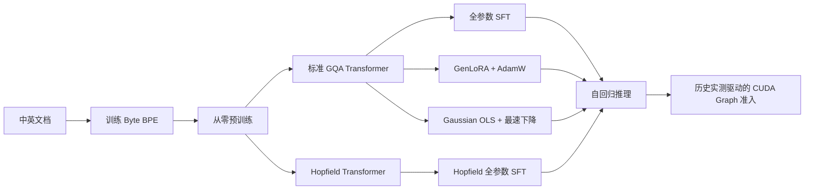

# From-Scratch LLM Training & Online Inference

**从零训练语言模型与在线推理加速**

A PyTorch implementation of bilingual language-model pretraining, supervised fine-tuning, and request-aware CUDA Graph scheduling. Standard GQA Transformer and modern Hopfield attention share the training workflow.

本项目覆盖 **模型实现 → 数据处理 → 中英预训练 → SFT → 自回归生成 → 推理性能评测**。重点是未知后续题长时，如何在保持输出一致的前提下，减少一次回答的总等待时间。

## 项目要点

- **手写模型**：字节 BPE、RMSNorm、RoPE、GQA、SwiGLU、AdamW 与训练循环；语言模型不调用 Transformers 的现成架构。
- **两种架构**：18 层、768 维、12 个 Q 头 / 3 个 KV 头，约 **1.61 亿参数**；标准注意力与现代 Hopfield 注意力。Hopfield 使用作者公式在当前 GQA 架构中的移植，不是原论文完整实验复现。
- **训练流程**：中英预训练；标准模型的全参数、GenLoRA 风格 RBF 低秩适配、Gaussian OLS + 最速下降三条 SFT 路线；Hopfield 自己的全参数 SFT。
- **在线推理**：KV cache、投影打包、共享 RoPE、预填充末层最后查询、Hopfield Triton 解码内核，以及根据历史实测收益决定的 Capture / Replay。
- **可复现入口**：CPU 小模型命令、示例数据生成器、单元测试、正式模型结构配置、性能协议与历史汇总结果。

## 流程



## 主要实测结果

**历史正式 GPU 实验：四个模型，每模型 256 个领域问题 + 32 个日常问题，各三轮。** 共同模型加载/预热排除；方法专属编译、试录、Capture 与阻塞等待计入。下表为三轮整轮平均每题耗时，不是单次最快值。

| 模型 | 最快已测对照 ms/题 ↓ | 动态在线方案 ms/题 ↓ | 耗时降低 | 加速比 ↑ |
|---|---:|---:|---:|---:|
| 标准全参数 SFT | 91.59 | **54.46** | 40.5% | 1.68× |
| GenLoRA SFT | 91.13 | **50.60** | 44.5% | 1.80× |
| OLS + 最速下降 SFT | 122.83 | **59.60** | 51.5% | 2.06× |
| Hopfield 全参数 SFT | 105.71 | **52.28** | 50.5% | 2.02× |

对应路径在冻结工作负载上核验了完整 token 与 EOS 一致。不同路径的精度配置存在差别，因此这是通过输出检查的完整执行方案比较，不代表纯策略的同精度因果效应，也不代表所有热态指标均最优。详见 [完整结果与消融](docs/RESULTS.md) 和 [计时协议](docs/BENCHMARK_PROTOCOL.md)。

## 快速开始

Python 3.12+；先安装适合本机的 PyTorch。以下全部默认 CPU，不自动占用 GPU。

```bash
python -m venv .venv
# Linux: source .venv/bin/activate
# Windows PowerShell: .venv\Scripts\Activate.ps1
python -m pip install -r requirements.txt
python -B -m unittest discover -s tests -v
python -B scripts/make_demo_data.py --output .runtime/input
python -B main.py --workspace .runtime/run prepare --corpus .runtime/input/pretrain --name demo --vocab-size 512
python -B main.py --workspace .runtime/run pretrain --config configs/pretrain-demo.json --name demo-base
python -B main.py --workspace .runtime/run generate --kind base --checkpoint artifacts/models/demo-base/best.pt --tokenizer demo --prompt "The robot" --max-new-tokens 8
```

然后完成一条全参数 SFT：

```bash
python -B main.py --workspace .runtime/run register-sft --name demo-qa --tokenizer demo --train .runtime/input/sft/train.jsonl --dev .runtime/input/sft/dev.jsonl
python -B main.py --workspace .runtime/run sft --config configs/sft-full-demo.json --name demo-full
python -B main.py --workspace .runtime/run generate --checkpoint artifacts/models/demo-full/best.pt --tokenizer demo --prompt "What is a robot?" --max-new-tokens 8
```

小配置只训练两步，用于验证程序链路，**不会得到正式问答能力**。三种标准 SFT 都直接使用同一个预训练检查点，互不继续训练。完整命令及数据格式见 [运行手册](docs/USAGE.md)。

## 代码导航

| 模块 | 源码 |
|---|---|
| 命令行与数据注册 | [main.py](main.py) |
| Byte BPE | [bpe.py](src/mlsystem/bpe.py) |
| GQA / RMSNorm / SwiGLU / RoPE | [components.py](src/mlsystem/components.py) |
| Transformer 与跨层 Hopfield 状态 | [model.py](src/mlsystem/model.py) |
| 预训练与检查点 | [training.py](src/mlsystem/training.py) |
| SFT / GenLoRA / OLS | [sft.py](src/mlsystem/sft.py), [genlora.py](src/mlsystem/genlora.py), [ols_rbf.py](src/mlsystem/ols_rbf.py) |
| 在线收益判断与图池管理 | [online_cuda_policy_v2.py](inference_cuda/online_cuda_policy_v2.py) |
| 请求计时、Capture 与 Replay | [online_cuda_engine_v2.py](inference_cuda/online_cuda_engine_v2.py) |
| Hopfield Triton 注意力 | [hopfield_inference_triton_v1.py](inference_cuda/hopfield_inference_triton_v1.py) |
| 可选 PCA + SOM 检索 | [retrieval.py](src/mlsystem/retrieval.py) |

进一步阅读：[架构](docs/ARCHITECTURE.md) · [训练与数据](docs/TRAINING.md) · [推理设计](docs/INFERENCE.md) · [数据说明](docs/DATA_CARD.md) · [实现与引用](NOTICE.md)。

## 发布范围

这里是课程工程的便携公开核心，不包含内部服务器管理脚本、模型权重、完整训练语料、论文全文、个人简历或任何未公开 VLA 研究代码。可先运行 CPU 验证流程；完整训练与 CUDA 性能复现实验需要自行准备授权数据、检查点和匹配设备。SOM 只提供证据检索，不代替模型生成答案。
