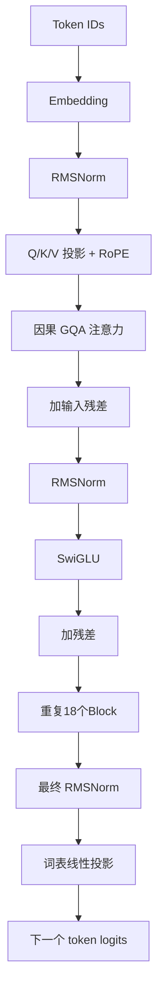

# 模型架构

## 公共结构

训练规模：32,000 词表，18 个 Block，隐藏维度768，SwiGLU 中间维度2048，12个查询头、3个KV头，每头64维；参数总量160,657,152。模型容量1024 token，预训练序列长度512，正式推理预算为提示与回答合计512。

## Hopfield 注意力

`hopfield_official_v8` 对每层缩放后的 QK 分数保留跨层状态。首层 H1=S1；后续 Hl=alpha_prime*H(l-1)+(1-alpha_prime)*Sl。因果掩码后执行 softmax，得到权重并与 V 结合；可见状态混合在输出投影之前完成。状态在一次完整前向的层间传递，每个请求重新开始，不跨用户保存。

源代码同时保留历史 `hopfield` 枚举用于兼容旧检查点；本仓库正式 Hopfield 配置使用 `hopfield_official_v8`，不要将两者权重重新解释为相同公式。标准 Transformer 前向不引入 Hopfield 分数状态。

这是一种在当前 Pre-RMSNorm/RoPE/GQA/SwiGLU 结构中的机制移植；当前项目没有复现作者整套 GPT-2 训练设置，不将有限结果写成论文结论的普遍验证。

## 三种标准 SFT

| 路线 | 更新内容 | 目标与优化 |
|---|---|---|
| 全参数 | 全部语言模型参数 | 答案 token 交叉熵，AdamW |
| GenLoRA 风格 | 内部线性层的 RBF 生成低秩适配器 | 答案 token 交叉熵，AdamW |
| OLS + 最速下降 | Gaussian 残差适配器，基座冻结 | TRAIN 答案误差监督选择中心，再最速下降 |

OLS 路线与 GenLoRA 的适配位置/结构不同，不能把它们解释成只换了优化器的相同网络。Hopfield 额外从自己的预训练基座开展全参数 SFT。
