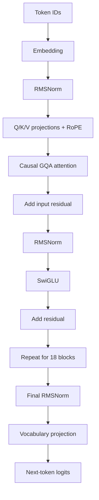

# Model Architecture

## Shared Structure

The full-size configuration uses a 32,000-token vocabulary, 18 blocks, hidden size 768, SwiGLU intermediate size 2048, 12 query heads and 3 KV heads, with 64 dimensions per head. It contains 160,657,152 parameters. The model supports a capacity of 1024 tokens; pretraining uses sequences of 512, and the evaluated inference budget is 512 tokens for prompt and answer combined.

## Hopfield Attention

`hopfield_official_v8` preserves cross-layer state for scaled QK scores. In the first layer, `H1 = S1`; subsequent layers use `Hl = alpha_prime * H(l-1) + (1-alpha_prime) * Sl`. Apply the causal mask and softmax, then combine the attention weights with V. Visible-state mixing occurs before the output projection. State is passed between layers within a forward pass and reset for each request; it is not shared between users.

The historical `hopfield` enum remains for compatibility with older checkpoints. The release configurations use `hopfield_official_v8`; do not reinterpret checkpoints for the two variants as using the same equations. Standard Transformer forward passes introduce no Hopfield score state.

This ports the mechanism into a Pre-RMSNorm/RoPE/GQA/SwiGLU architecture. It does not reproduce the authors' complete GPT-2 training setup or establish their conclusions universally from limited results.

## Three Standard SFT Routes

| Route | Updated parameters | Objective and optimization |
|---|---|---|
| Full-parameter | All language-model parameters | Answer-token cross-entropy, AdamW |
| GenLoRA-style | RBF-generated low-rank adapters in internal linear layers | Answer-token cross-entropy, AdamW |
| OLS + steepest descent | Gaussian residual adapter; frozen base model | Select centers using TRAIN answer errors, then apply steepest descent |

OLS and GenLoRA differ in adapter structure and placement; they are not the same network with only the optimizer changed. The Hopfield model additionally receives full-parameter SFT starting from its own pretrained checkpoint.
