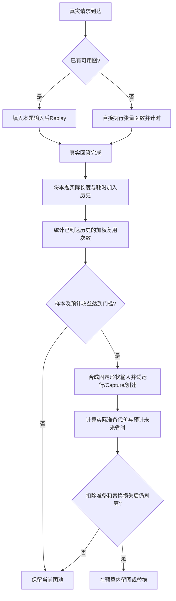

# 一次回答的推理与在线图调度

## 优化对象

输入问题先分词；预填充并行处理全部提示，建立每层KV cache并给出首个回答token；解码每次只处理一个新token，更新KV并预测下一个token；遇EOS或预算结束后停止。目标是减少一次回答的等待，输出内容、token与结束行为仍需逐条核验。

## 执行层

1. 缓存每层历史K/V，避免每次重算完整前缀。
2. 按可合并的权重布局打包QKV和SwiGLU投影；共享位置编码计算。
3. 预填充最后一层只计算用于首token预测的最后查询输出，但仍建立解码所需的前缀K/V。
4. 标准注意力调用PyTorch现成算子；Hopfield解码使用Triton注意力内核，按需JIT。
5. 在线v2跳过预填充/解码整段`torch.compile`包装；底层库算子继续使用已有GPU实现。这与“完全不调用GPU算子”不同。

## 在线决策

- 预填充与解码都按16对齐的候选长度，实际请求长度用于有效位置与因果掩码，补齐区域不作为真实历史。
- 最近24个已完成请求构成历史，权重按0.9衰减；预测窗口为未来24个请求。不能读取尚未到达的问题或预先利用全部题长。
- 候选需要至少3条相应直接路径耗时样本；同桶试录有16请求冷却，每题最多一次候选试录。
- 共用8张图、384MiB图池预算；图池内存使用估算值，实际Capture时间及三次Replay测速实测。
- 预计复用省时要扣除实测准备成本，替换旧图还要扣除失去旧图预计收益；不通过就继续直接路径。
- Capture记录固定内存与形状的GPU操作；Replay使用本题新输入重放操作，不复用旧答案。

源码阅读顺序：`online_cuda_policy_v2.py` → `online_cuda_engine_v2.py` → `online_cuda_engine_v1.py` → `allarchitectures_inference_engine_v1.py`。其余`inference_cuda/`文件包含继承链、注意力内核及共同方法实现，不要只复制两份入口文件。

## 运行

对可信SFT检查点，`main.py ... generate --device cuda --backend cuda-online --requests <JSONL>`可按到达顺序复用同一进程的历史。输入每行含`question`与可选`context`。提示加生成预算不得超过512。不要将不同进程之间的缓存看作同一个在线图池。

公开版的CUDA路径来自既有实现，本次发布只重跑CPU测试，不占用GPU。历史速度见[结果](RESULTS.md)，计时口径见[实验协议](BENCHMARK_PROTOCOL.md)。
