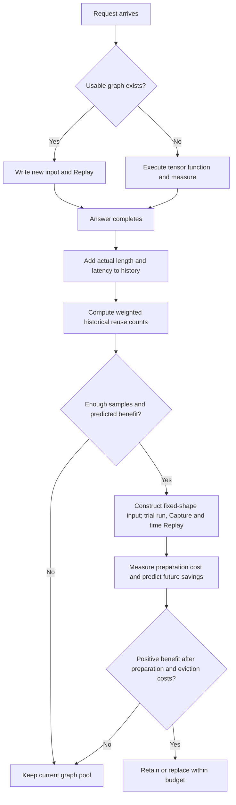

# Answer Generation and Online Graph Scheduling

## Optimization Target

Tokenize the question. Prefill processes all prompt positions in parallel, builds each layer's KV cache and predicts the first answer token. Decoding processes one new token at a time, updates the cache and predicts the next token. Stop at EOS or the generation budget. The goal is to reduce request latency while checking output text, tokens and stopping behavior for each request.

## Execution Layer

1. Cache each layer's past K/V to avoid recomputing the entire prefix.
2. Pack QKV and SwiGLU projections where weight layouts permit; share positional-encoding computation.
3. In the final prefill layer, compute only the last query output needed for the first token, while retaining prefix K/V required by decoding.
4. Standard attention uses existing PyTorch operators. Hopfield decoding uses a Triton attention kernel compiled by JIT when needed.
5. Online v2 bypasses whole-function `torch.compile` wrappers for prefill and decoding. Underlying library operators still use their existing GPU implementations.

## Online Decisions

- Both prefill and decoding consider candidate lengths aligned to 16. Actual lengths determine valid positions and causal masks; padding is not real history.
- History contains the latest 24 completed requests with exponential decay 0.9; the prediction horizon is 24 future requests. The policy cannot inspect future questions or their lengths.
- A candidate requires at least three relevant direct-path timing samples. Trial capture of the same bucket has a 16-request cooldown. At most one candidate is trialed per request.
- The pool shares a budget of eight graphs and 384 MiB. Graph memory is estimated; Capture duration and three Replay timings are measured.
- Predicted reuse savings must exceed measured preparation cost. Replacing a graph also subtracts its predicted lost benefit. Otherwise, keep the direct path.
- Capture records GPU operations with fixed shapes and memory addresses. Replay runs them on the new request's inputs; it does not reuse an old answer.

Read the source in this order: `online_cuda_policy_v2.py` → `online_cuda_engine_v2.py` → `online_cuda_engine_v1.py` → `allarchitectures_inference_engine_v1.py`. Other `inference_cuda/` files provide the inheritance chain, attention kernels and shared methods. Copying only two entry files is insufficient.

## Running

For trusted SFT checkpoints, `main.py ... generate --device cuda --backend cuda-online --requests <JSONL>` retains one process's history across requests in arrival order. Each input line contains `question` and optional `context`. Prompt plus generation budget must not exceed 512 tokens. Caches in different processes are not one online graph pool.

The CUDA path is the existing implementation. This release reran CPU checks only and did not use a GPU. See [historical results](RESULTS.md) and the [benchmark protocol](BENCHMARK_PROTOCOL.md).
